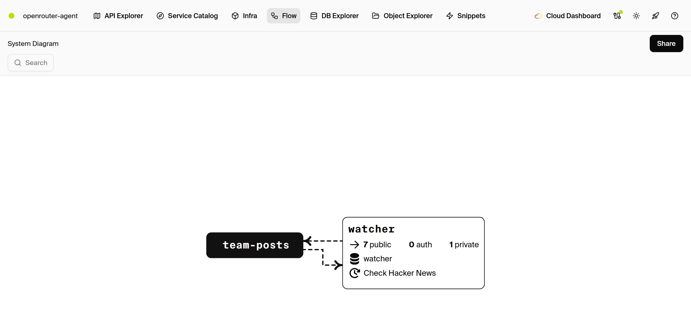
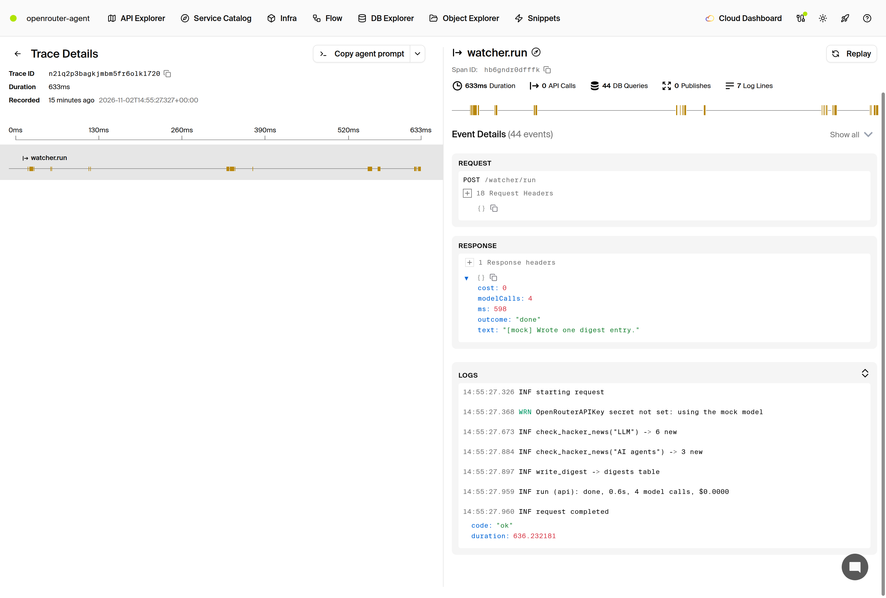
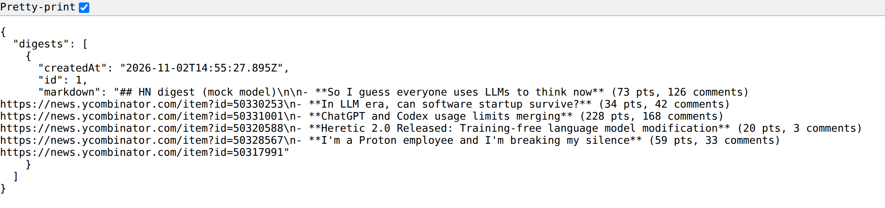

# Always-on agent

An Encore.ts port of OpenRouter's tutorial [How to Build Your Own Always-On AI Agent](https://openrouter.ai/blog/tutorials/build-always-on-ai-agent/), using `@openrouter/agent`.







## Run locally

Install the [Encore CLI](https://encore.dev/docs/install) and [Docker](https://docs.docker.com/get-docker/).

```bash
encore app create openrouter-agent --example=ts/openrouter-agent
cd openrouter-agent
npm install
encore secret set --type local OpenRouterAPIKey
encore run
```

Without `OpenRouterAPIKey`, the app calls a built-in mock and still reads live Hacker News data.

Cron jobs do not fire under `encore run`. Trigger a check by hand:

```bash
curl -X POST http://localhost:4000/watcher/run -d '{}'
curl http://localhost:4000/watcher/digests
curl http://localhost:4000/watcher/status
```

`/watcher/run` and `/watcher/decisions` need an auth handler before exposing them publicly.

While `encore run` is running, open <http://localhost:9400/> for the [local development dashboard](https://encore.dev/docs/ts/observability/dev-dash).

## Docs

- [Encore.ts](https://encore.dev/docs/ts)
- [Cron jobs](https://encore.dev/docs/ts/primitives/cron-jobs)
- [SQL databases](https://encore.dev/docs/ts/primitives/databases)
- [Pub/Sub](https://encore.dev/docs/ts/primitives/pubsub)
- [Secrets](https://encore.dev/docs/ts/primitives/secrets)
