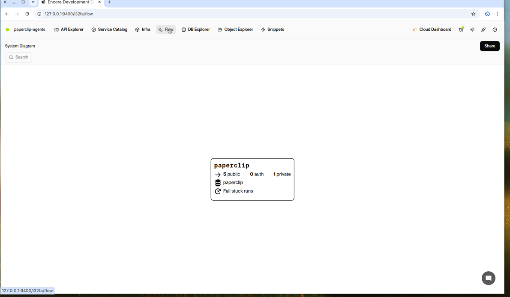
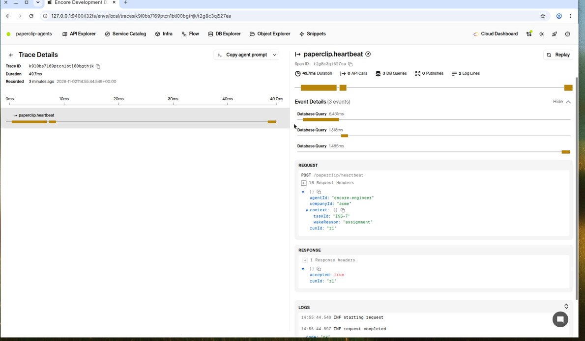
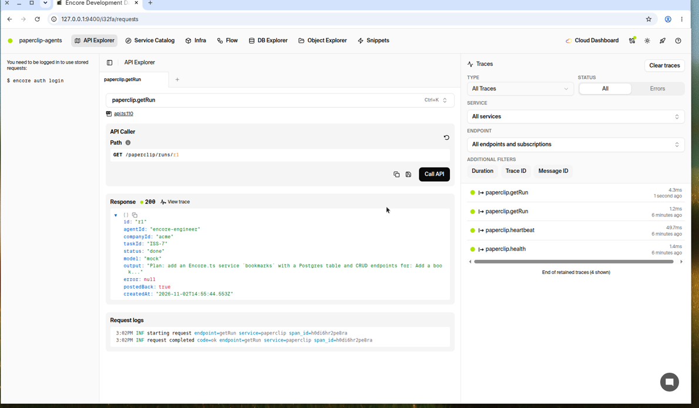
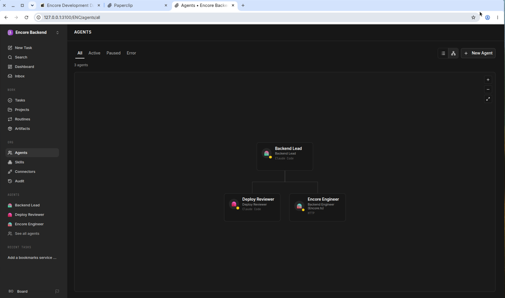
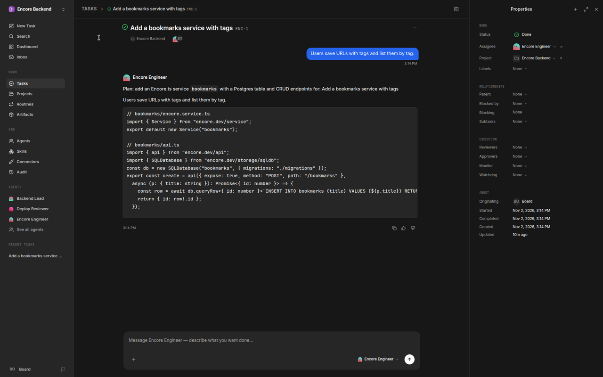

# Paperclip agent team

An Encore.ts service that a [Paperclip](https://github.com/paperclipai/paperclip) agent team calls on each run, with the team package in `team/encore-backend`.











The first three are the local Encore dashboard. The last two are the team imported into Paperclip, and the comment Encore Engineer posted on the issue.

## Run locally

Install the [Encore CLI](https://encore.dev/docs/install), Node 20 or newer, and [Docker](https://www.docker.com/).

```bash
encore app create paperclip-agents --example=ts/paperclip-agents
cd paperclip-agents
npm install
node scripts/fake-paperclip.mjs &
PAPERCLIP_API_URL=http://127.0.0.1:3999 PAPERCLIP_API_KEY=test encore run
```

`scripts/fake-paperclip.mjs` stands in for the Paperclip API. Send a heartbeat, then read the run:

```bash
curl -X POST localhost:4000/paperclip/heartbeat \
  -d '{"runId":"r1","agentId":"encore-engineer","companyId":"acme","context":{"taskId":"ISS-7","wakeReason":"assignment"}}'
curl localhost:4000/paperclip/runs/r1
```

With no OpenAI key the worker uses a mock model. To call OpenAI, set the `OpenAIKey` secret (`OPENAI_API_KEY` in the environment also works locally):

```bash
encore secret set --type dev,local OpenAIKey
```

`AGENT_MODEL` sets the model (default `gpt-4o-mini`).

To use a real Paperclip server, set `PaperclipAPIURL` and `PaperclipAPIKey` (or `PAPERCLIP_API_URL` and `PAPERCLIP_API_KEY` locally). Import the team, point an agent's http adapter at `http://127.0.0.1:4000/paperclip/heartbeat`, and assign it an issue.

```bash
pnpm paperclipai company import ./team/encore-backend --target existing -C <company-id> --yes
```

While `encore run` is running, open http://localhost:9400 for the [local development dashboard](https://encore.dev/docs/ts/observability/dev-dash).

## Docs

- [Encore.ts](https://encore.dev/docs/ts)
- [SQL databases](https://encore.dev/docs/ts/primitives/databases)
- [Cron jobs](https://encore.dev/docs/ts/primitives/cron-jobs)
- [Secrets](https://encore.dev/docs/ts/primitives/secrets)
- [Local development dashboard](https://encore.dev/docs/ts/observability/dev-dash)
- [Paperclip](https://github.com/paperclipai/paperclip)

Skills in `team/encore-backend/skills` are Apache-2.0. See `team/encore-backend/LICENSE-encoredev-skills`.
